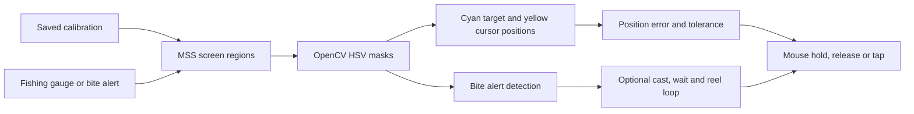

# NTE Fishing Automation

A Windows desktop utility that tracks the fishing gauge in *Neverness to Everness* and drives the reel control from the observed cursor position.

The Tkinter interface saves screen regions, color thresholds and control settings in `config.json`. It supports the fishing gauge on its own and an optional loop that waits for the bite alert and casts again when the gauge disappears.

## Vision and control pipeline



The worker samples the selected screen regions and converts each frame to HSV. In the gauge it compares the target and cursor positions, then adjusts the reel input using the configured tolerance and control direction. The optional recast loop uses a separate region for the bite alert.

## Run from source

Use Windows and Python with Tkinter. From the repository root in PowerShell:

```powershell
python -m venv .venv
.\.venv\Scripts\python.exe -m pip install -r requirements.txt
.\.venv\Scripts\python.exe app.py
```

1. Open the fishing gauge in the game and expand **Calibration & Setup** in the tool.
2. Choose **Select Fishing Gauge Area**, draw the rectangle around the slider, and press **Enter**. Select the **Fish on Hook! Alert Area** as well if using the optional recast loop.
3. Use the cyan target and yellow cursor pickers while the gauge is visible. Check each mask preview and press **Q** to save the selected color.
4. Start or toggle the worker with **F8**. Press **F9** to stop it. If the input moves the cursor away from the target, check **Invert Controls** in Bot Settings.

The utility captures visible desktop pixels. Recheck the regions and color masks after changing monitors, game scaling, or display settings.

## Code map

| Component | Responsibility |
| --- | --- |
| [Desktop app](app.py) | Tkinter interface, calibration, hotkeys and tracking worker |
| [Calibration utility](calibration.py) | Standalone OpenCV calibration preview |
| [Standalone tracker](main.py) | Earlier entry point with hard-coded calibration |
| [Configuration](config.json) and [dependencies](requirements.txt) | Saved calibration and Python packages |
