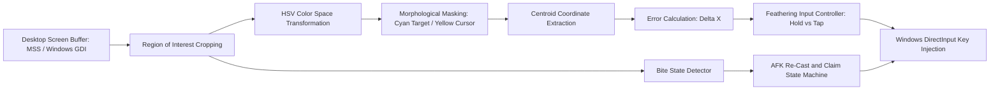

# nte-fishing-automation

Computer-vision-guided automation bot with real-time HSV color tracking, non-linear PID-style input feathering, and state-machine AFK loops for Neverness to Everness.

## Overview

NTE Fishing Automation is a desktop computer vision utility designed to automate the fishing minigame in Neverness to Everness (NTE). It captures screen regions at 30+ FPS via Windows GDI, tracks target indicators and dynamic cursor positions via OpenCV HSV mask filtering, and applies micro-input feathering algorithms to simulate humanized reeling trajectories while evading heuristic macro detection.

## Architecture and Pipeline

The application processes frames through an asynchronous tracking and input synthesis pipeline.



- Vision Pipeline: Real-time window capture processes region-of-interest (ROI) frames, transforming RGB pixels into HSV space to isolate target centroids under varying lighting.
- Error Control: Calculates delta distance between target and cursor. Far distances trigger continuous key down events; sub-threshold distances engage variable micro-tap feathering to eliminate overshooting.
- State Machine: Automates the complete lifecycle: cast initiation, bite detection via template difference, mini-game execution, loot claiming, and automated re-casting.
- User Safety & Hotkeys: Global keyboard listeners (`F8` start, `F9` emergency kill-switch) provide immediate worker thread preemption.

## Tech Stack

| Component | Technology | Description |
| :--- | :--- | :--- |
| Runtime | Python 3.10+ | Execution environment (requires Windows Administrator) |
| Vision / Tracking | OpenCV (`cv2`), NumPy, MSS | Real-time screen capture and HSV threshold filtering |
| Input Simulation | PyDirectInput, Keyboard | Low-level Windows scancode simulation and global hotkey interception |
| GUI & Calibration | Tkinter, CustomTkinter | Interactive ROI selection and color threshold calibration tool |

## Project Structure

```text
Automated_Fishing_Bot_For_NTE/
├── .gitignore            # Git exclusion filters
├── README.md             # Technical documentation
├── app.py                # Main GUI application and threading coordinator
├── calibration.py        # Interactive ROI and HSV color calibration window
├── main.py               # Core CV tracking loops and input feathering algorithms
├── config.json           # User calibration data, coordinates, and tolerances
├── requirements.txt      # Python package manifest
└── Start_Fishing_Bot.bat # Windows administrator launch script
```

## Setup and Prerequisites

### Prerequisites
- Windows 10/11
- Python 3.10 or higher
- Administrator privileges (required by Windows DirectInput interception)

### Installation

1. Clone repository:
   ```bash
   git clone https://github.com/Gehrman-Sparrow42/Automated_Fishing_Bot_For_NTE.git
   cd Automated_Fishing_Bot_For_NTE
   ```

2. Configure virtual environment:
   ```bash
   python -m venv .venv
   .venv\Scripts\activate
   ```

3. Install dependencies:
   ```bash
   pip install -r requirements.txt
   ```

## Usage Examples

### Starting the Calibration and Bot UI
Run from an elevated administrator console:
```bash
python app.py
```

### Calibration Workflow
1. Launch the game in windowed or borderless fullscreen mode.
2. Under **Calibration & Setup**, click **Select Fishing Bar Area** and drag a rectangle enclosing the reel meter.
3. Click **Detect CYAN Target** and click the target marker to isolate its HSV spectrum.
4. Click **Detect YELLOW Cursor** to calibrate slider cursor tracking.
5. Press `F8` to begin the automation loop; press `F9` to halt execution instantly.

## Notes and Constraints

- Display Scaling: Windows Display DPI scaling must match between monitor settings and game rendering resolution to prevent coordinate offset errors.
- Input Injection: Certain anti-cheat hooks block simulated software inputs; running the terminal as Administrator is mandatory for DirectInput scancode injection.
